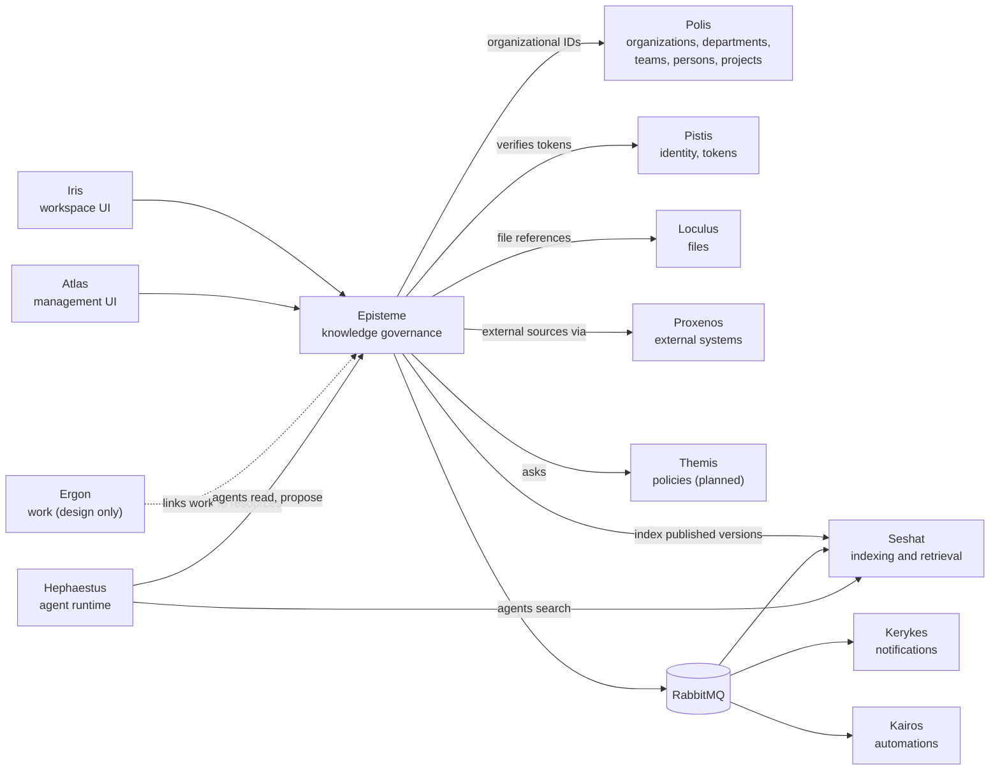
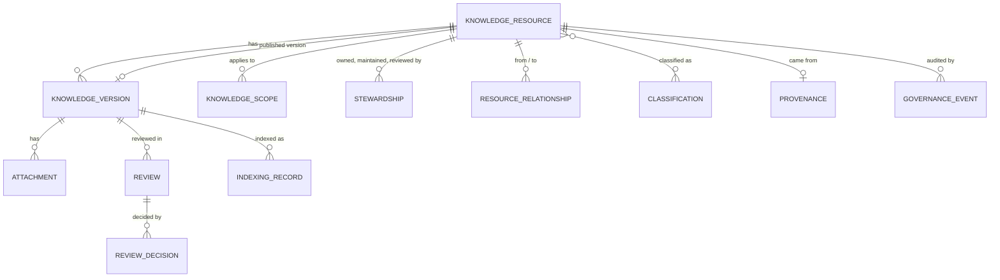
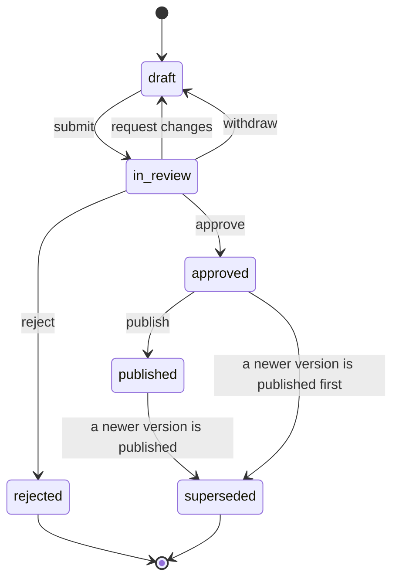
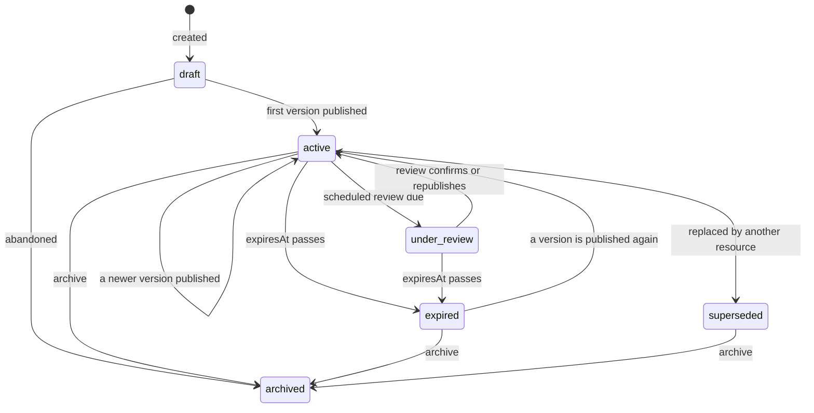
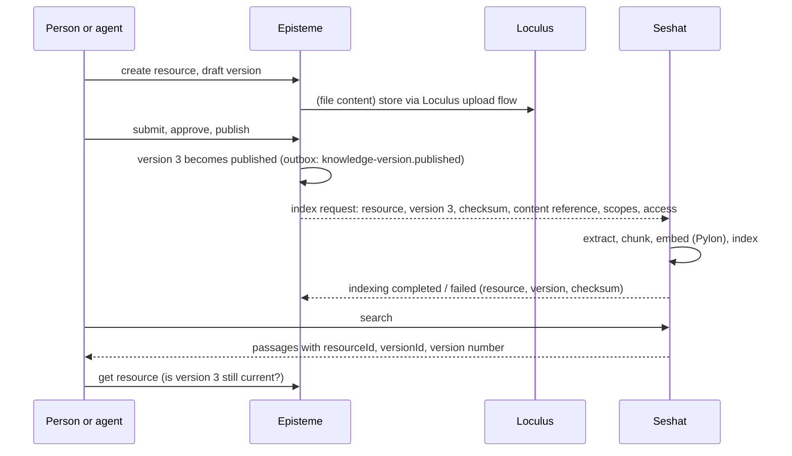

# CLAUDE.md

This file provides guidance to Claude Code (claude.ai/code) when working with code in this repository.

## Episteme

Episteme is the Aether OS service for **knowledge management and governance**: the canonical record of what an organization knows, who is accountable for it, where it applies, which version is authoritative, and whether it may be used. *Epistēmē* is Greek for "knowledge, understanding": knowledge that has been examined and can be relied on, as opposed to opinion.

Package: **`@aether-os/episteme`**.

Status: **design only, no code yet.** This file is the starting point for building the service. It says what Episteme owns, how it fits with the other services, and which rules its code must follow.

- Statements without a marker are **decided**: they follow from the platform's agreed design (`../CLAUDE.md`, `../docs/*.md`) or from Episteme's mission.
- **(Proposal)** marks a recommendation that still needs validation. Implement it only after it's confirmed, or as the smallest version that can be changed cheaply.
- **Open questions** are listed in their own section near the end. Don't settle them silently in code: ask, or write the decision into this file first.

Read the root `../CLAUDE.md` first. It describes the platform, the shared conventions (Krepis, contracts, events, identity) and how the workspace is built. Read `../docs/knowledge.md` and `../seshat/CLAUDE.md` before changing anything in this file: Seshat already holds part of what Episteme is meant to own (below, **Current state**).

## Aether OS, briefly

Aether OS combines two capabilities:

- **Agent factory:** define, configure, evaluate, deploy and operate AI agents and agent councils.
- **Organizational operating system:** give humans and agents the organization's context, responsibilities, knowledge, resources and work.

People and agents are both participants in the organization. They belong to departments and teams, work on projects, use the organization's knowledge and do assigned work. The platform is made of independently deployable services. Each owns one domain and its data, and they talk through explicit HTTP APIs and RabbitMQ events, never through each other's databases.

## Mission

Episteme makes organizational knowledge **trusted, structured and governed**, so that people and agents can rely on it. For any piece of knowledge it answers:

- What knowledge does this organization have?
- Which documents, policies and procedures are authoritative, and which version is valid now?
- Who owns it, and who maintains, reviews and approves it?
- Which departments, teams and projects is it relevant to?
- Has it been reviewed and approved, and when must it be reviewed again?
- Which people and agents may use it? What is shared across the organization, and what is restricted?
- Where did it come from, and what changed?
- How can it be found, kept current and improved?

It is not a document management system. Knowledge is a **first-class organizational asset**, with an identity that outlives any one file, version or storage location.

### Principles

1. **Ownership.** Every knowledge resource has an accountable owner (a person, or an ownership arrangement through a team or department).
2. **Context.** Knowledge belongs to one organization and may apply to its departments, teams and projects.
3. **Lifecycle.** Resources are drafted, reviewed, approved, published, superseded and archived.
4. **Versioning.** Every change is traceable. Published content is never silently overwritten.
5. **Governance.** Publication and access are subject to authorization and policy.
6. **Discoverability.** People and agents can find what is relevant to them.
7. **Reuse.** One resource can apply to several organizational contexts.
8. **Auditability.** Important changes and governance decisions are recorded.
9. **Storage independence.** Episteme owns knowledge metadata and lifecycle, not the bytes (Loculus).
10. **Retrieval independence.** Episteme isn't coupled to a vector store or an embedding provider (Seshat, Pylon).

## Service names in this file

The brief that started Episteme used some service names that differ from this repository. This file uses **the repository's names**, because they are what the code, contracts and docs use. The mapping below is itself an open question until someone confirms it (Open questions, 1).

| Responsibility | Name in this repository | Name in Episteme's brief |
|---|---|---|
| External integrations: OAuth connections, provider APIs, webhooks | **Proxenos** (`../proxenos`) | Kerykes |
| Notifications: inboxes, email, later Slack and Teams | **Kerykes** (`../kerykes`) | (not mentioned) |
| Policies and their enforcement (APS) | **Themis** (planned) with OPA, enforced through APS in Hephaestus | Aegis Control |
| Shared SDKs, tool contracts, schemas, helpers | **Krepis** (`@aether-os/krepis`) and **contracts** (`@aether-os/contracts`) | Forge |
| Model calls and embeddings | **Pylon** (`../pylon`) | (not mentioned) |
| Automations: event-driven triggers bound to agents | **Kairos** (`../kairos`) | Kairos (described as a general workflow orchestrator) |

Kairos is narrower in this repository than in the brief: today it binds triggers (GitHub issue events) to agents and creates tasks in Hephaestus. Schedules, waits, branching and human approval steps are not built. Anything Episteme expects from "Kairos as a workflow engine" is a dependency to confirm, not something to rely on (Open questions, 7).

## Where Episteme sits

## Service ownership boundaries

| Service | Owns | What it means for Episteme |
|---|---|---|
| **Polis** | Organizations, departments, teams, persons, memberships, projects | Episteme stores Polis IDs (organization, department, team, project, person) and never keeps its own organizational entities. It may cache display names, marked non-authoritative. |
| **Pistis** | Users, authentication, tokens, service accounts, API keys | Every request carries a Pistis token, verified through Krepis. A Polis **person** is not a Pistis **user**: a person may have no account (`../polis/CLAUDE.md`, Persons). Ownership names a person or a user deliberately (Open questions, 4). |
| **Agora** | Agent and council definitions and versions | Episteme refers to agents only through the principal on a token (a service account) or an Agora agent ID in provenance. It defines no agents. |
| **Hephaestus** | Running agents, tasks, sessions | Agents reach Episteme with task or session tokens, through tools Hephaestus offers. Episteme never runs an agent. |
| **Ergon** | Work items, assignments, artifacts, handoffs (design only) | Ergon owns the work item; Episteme owns the governed resource it produces or needs. They link by ID. |
| **Kairos** | Automations (triggers bound to agents) | It may start knowledge work (a scheduled review, an import) once it supports it. Episteme owns the lifecycle; Kairos owns running the workflow. |
| **Seshat** | Indexing, chunking, embeddings (through Pylon), search, retrieval tools | Episteme asks Seshat to index **published** versions and reads indexing status back. It never chunks, embeds or ranks. |
| **Loculus** | Files in S3-compatible storage, signed URLs | Attachments and binary content live in Loculus. Episteme stores Loculus file IDs, never signed URLs (`../CLAUDE.md`, Design rule). |
| **Proxenos** | Connections to external systems, OAuth, webhooks | Importing or synchronizing from external knowledge platforms goes through Proxenos. Episteme holds no provider credentials. |
| **Themis** (planned) | Versioned policy sets served to OPA (APS) | Policy decisions (who may use what, retention rules) come from it once built. Episteme has no policy engine of its own. |
| **Kerykes** | Notifications | Episteme emits events (review requested, review due); Kerykes decides whom to tell. |
| **Iris / Atlas** | The workspace and the management UI | Both call Episteme's API. No backend-for-frontend service is created for them. |

## Current state of the platform

Episteme doesn't exist yet, but its domain isn't empty. Read this before designing anything.

| What | Where it lives today | Notes |
|---|---|---|
| **Knowledge items with a lifecycle** | **Seshat** (`../docs/knowledge.md`, built) | Typed items (`document`, `decision`, `fact`, `convention`, `architecture`, `lesson`) per project and per department. Lifecycle `proposed → accepted → superseded / rejected / retired`. Versions on every edit. `source` provenance (`person`, `task`, `council`, `document`, `repository`, …). `reviewBy` dates. Events `knowledge-item.*`. |
| **Approval** | Seshat | People with `knowledge:write` create items as accepted. Agents and session tokens only propose. `knowledge:approve` accepts, rejects, retires. |
| **Permissions** | Krepis's fixed role → permission table | `knowledge:read`, `knowledge:write`, `knowledge:propose`, `knowledge:approve` (project scope), `org:knowledge:write` (department items). |
| **Documents** | Files in Loculus, or repository files read through Proxenos, indexed by Seshat | Content lives once, in Loculus or the repository. Seshat keeps a reference. |
| **Agents' knowledge tools** | Hephaestus | `search_knowledge`, `get_knowledge`, `read_knowledge`, `propose_knowledge`, all calling Seshat with the task token. |
| **Pinned context** | Hephaestus tasks pin Seshat item versions at creation | Pinned versions must stay readable, whatever Episteme does. |
| **Iris's Knowledge page** | Iris, against Seshat | Search, write, upload, review proposals. |

So the brief's split (Episteme governs, Seshat retrieves) **moves an existing responsibility out of a built service**. That is a migration, not a green field:

- Seshat's knowledge items, their lifecycle, approvals, versions and provenance become Episteme's knowledge resources.
- Seshat keeps indexing, passages, embeddings, hybrid search and the retrieval tools.
- `../docs/knowledge.md`, `../seshat/CLAUDE.md`, `../ergon/CLAUDE.md` (which says Ergon must not own "project knowledge … (Seshat)") and the root `../CLAUDE.md` all describe the current split and must change with it.

How to migrate, and in which order, is undecided (Open questions, 2). **(Proposal)** Episteme first owns the new kinds of knowledge (policies, procedures, handbooks) while Seshat keeps project items. Then Seshat's governance moves over once Episteme's model is proven, with an import that keeps item IDs and versions (as Agora did with `pnpm import:hephaestus`), so pinned task context still resolves.

## What Episteme owns

- **KnowledgeResource:** the identity, metadata and status of a governed piece of knowledge.
- **KnowledgeVersion:** immutable content versions and their history.
- **Content references:** inline structured or Markdown content, Loculus file references, external references.
- **The lifecycle:** drafting, review, approval, publication, superseding, archival, and the scheduled reviews and expirations that drive it.
- **Ownership and governance roles:** owners, maintainers, reviewers, approvers, per resource.
- **Organizational scope:** which organization, departments, teams and projects a resource applies to.
- **Taxonomy:** knowledge types, categories, tags and metadata schemas.
- **Relationships** between resources.
- **Provenance:** where a resource came from and how it was transformed.
- **Governance audit:** who did what, when and why, for every lifecycle and governance change.
- **Indexing requests and indexing status** as Episteme sees them (what it asked Seshat to index, and what Seshat reported). Not the index itself.

## Domain model

Names are the domain's. Tables and API payloads follow from it, but aren't it. **(Proposal)** for everything beyond the entities' existence and the rules marked decided.

### KnowledgeResource

The stable identity of a piece of knowledge, independent of its content and where that content is stored.

- **Fields to consider:** `id` (UUIDv7), `organizationId`, `knowledgeType`, `title`, `description`, `status` (the resource's lifecycle, below), `currentVersionId` (the latest version), `publishedVersionId` (the authoritative one, or none), `reviewDueAt`, `publishedAt`, `expiresAt`, `tags`, `metadata` (validated against the type's schema, if it has one), `createdBy`, `updatedBy`, `createdAt`, `updatedAt`, `version` (the row's version, the `aggregateVersion` of its events).
- **Decided:** every resource has exactly one `organizationId`, set at creation and never changed. There are no cross-organization resources.
- **Decided:** the identity is stable. Retitling, moving between scopes or replacing the content never makes a new resource. Superseding by a *different* resource is a relationship (below), not an identity change.
- `title` and `description` belong to the resource. Whether a title change is versioned with the content is undecided (Open questions, 3).

### KnowledgeVersion

One immutable snapshot of a resource's content.

- **Fields to consider:** `id`, `resourceId`, `number` (1, 2, 3 … per resource), `content` (inline, or a reference), `contentFormat`, `checksum` (SHA-256 of the canonical content, for idempotent indexing and integrity), `changeSummary`, `authoredBy`, `createdAt`, `basedOnVersionId` (the version it was edited from, for restores and conflict detection), `state` (the version's lifecycle, below).
- **Decided:** a version that has been submitted for review is never edited. A change is a new version.
- **Decided:** a published version is never edited or deleted. It stays readable for audit and for anything that pinned it (tasks pin versions, `../docs/tasks.md`).
- **Decided:** restoring an older version creates a **new** version with that content (`basedOnVersionId` pointing at the old one). History is never rewritten.
- **(Proposal)** drafts are versions in the `draft` state that may be edited in place until submitted, rather than a separate "draft revision" entity. The alternative, an editable working copy plus immutable versions, is Open questions, 3.

### Content

- **Decided:** binary files and attachments live in **Loculus**. Episteme stores the Loculus file ID and its checksum, never a signed URL. Uploads follow Loculus's flow (declare, signed `PUT`, complete).
- **Decided:** content isn't chunked, embedded or vectorized here. That is Seshat's.
- **Formats to consider:** Markdown (what Seshat and the agents read today), a structured rich-text document (e.g. a ProseMirror/TipTap JSON tree), structured content per type (a policy's sections, a FAQ's question-and-answer pairs), a file (PDF, `.docx`) as the content itself, and an external reference (a URL or an external system's ID through Proxenos). Which is primary is Open questions, 5.
- **(Proposal)** whatever the authoring format, every version has a **canonical text rendering** (Markdown) that Seshat indexes and agents read, so retrieval never depends on the editor's format.
- **Decided:** content is untrusted input. It's stored and served as data, sanitized when rendered (Iris, Atlas), and never interpreted as instructions (Security, below).

### KnowledgeScope

Where a resource applies, as many-to-many associations: `(resourceId, scopeType, scopeId)` with `scopeType` in `organization | department | team | project`.

- **Decided:** a resource can apply to several departments, teams and projects at once. It's never forced into one department or one team.
- **Decided:** an organization-wide resource has an `organization` scope (or no narrower scope). It never needs an artificial department or team.
- **Decided:** scope IDs are Polis IDs, checked against Polis when set (an archived department refuses new associations, as Polis's own rules do). Polis stays the source of truth for the organizational structure.
- **Decided:** **scope is not authorization.** Being in a department a resource applies to grants nothing. Scope says where knowledge is *relevant* (for discovery, ranking, defaults); access is decided by permissions and policy (Security, below).
- **(Proposal)** Episteme keeps a version-guarded copy of what it needs from Polis's events (the status of organizations, departments, teams and projects; a project's department), like Seshat and Hephaestus do, so it can refuse writes to archived scopes without calling Polis on every request.

### Stewardship (ownership and governance roles)

Who is accountable and who takes part: `(resourceId, role, principal)` with `role` in `owner | maintainer | reviewer | approver`.

- **Decided:** every resource has at least one owner from creation. A resource can't be left without an owner: transferring ownership names the new owner in the same change.
- **Decided:** ownership and stewardship are **accountability, not access.** An owner still needs the permissions to act. Being made a reviewer doesn't grant read access the reviewer wouldn't otherwise have. Policy may require it (Open questions, 11).
- **Principals to consider:** a Polis person, a Pistis user, a Polis team or department (ownership held collectively), and for maintainers possibly a service account (an agent maintaining a runbook). Which ones each role accepts is Open questions, 4.
- **Decided:** stewardship refers to Polis and Pistis IDs only. No duplicate people or teams.

### Review and approval

- **Fields to consider:** a `Review` per version submitted (`versionId`, `requestedBy`, `requestedAt`, `dueAt`, `state`: `open`, `approved`, `rejected`, `withdrawn`), assigned reviewers, and `ReviewDecision`s (`reviewer`, `decision`: approve, reject or request changes, `comment`, `decidedAt`).
- **Decided:** an approval is recorded against a **specific version** (its ID and checksum), so what was approved is exactly what gets published.
- **Decided:** approving, rejecting and publishing are a principal's recorded decisions, with who, when and (for rejections) why.
- **(Proposal)** the platform's existing rule carries over: **people approve, agents propose.** Task and session tokens may draft and submit, never approve or publish, unless a policy explicitly allows it for a knowledge type (Open questions, 12).
- How many approvals a type needs, and from whom, is Open questions, 6.

### Classification (taxonomy)

- **Knowledge types**, from a platform vocabulary to start with: `policy`, `procedure`, `standard_operating_procedure`, `guideline`, `handbook`, `technical_documentation`, `architecture_decision`, `runbook`, `onboarding`, `business_rule`, `faq`, `research`, `principle`, `reference`. **(Proposal)** these, plus Seshat's (`document`, `decision`, `fact`, `convention`, `architecture`, `lesson`) mapped onto them for the migration.
- **Tags** (free-form, normalized) and **categories** (a shallow, curated tree).
- **(Proposal)** a **metadata schema per knowledge type** (a JSON Schema in Episteme's configuration, e.g. a policy's `effectiveFrom` and `regulatoryReference`), validated on write.
- **Decided:** no ontology engine, no reasoner, no RDF store. A flat vocabulary, a shallow category tree and tags, until a concrete requirement needs more.
- Global, per-organization or both is Open questions, 8.

### ResourceRelationship

Typed, directed links between resources of the same organization: `related_to`, `depends_on`, `supersedes`, `implements`, `describes`, `references`, `part_of`, `derived_from`.

- **Fields to consider:** `fromResourceId`, `toResourceId`, optionally `toVersionId` (a link to a specific version, e.g. "derived from version 3"), `type`, `createdBy`, `createdAt`.
- **Decided:** relationships never cross organizations.
- **Decided:** stored as rows in Episteme's Postgres and queried with SQL (recursive CTEs for impact analysis: "what depends on this policy?"). **No graph database** until a concrete requirement needs one.
- **(Proposal)** `supersedes` is set by the lifecycle (a published resource replacing another), not freely, so "what's current" can't be contradicted by a hand-made link.
- Representation and query details are Open questions, 9.

### Provenance

Where a resource came from: `sourceType` (`internal`, `import`, `sync`, `derived`, `ai_generated`, `work_artifact`, and Seshat's existing `person`, `task`, `council`, `document`, `meeting`, `repository` for the migration), `sourceSystem` (an external system, through Proxenos), `externalId`, `sourceUrl`, `importedAt`, `originalAuthor`, and a `transformations` history (converted, summarized, translated, by whom or what).

- **Decided:** an external system stays authoritative for its own records. Episteme keeps a governed copy with its provenance, and says so.
- **Decided:** **AI-generated knowledge is never published automatically.** It enters as a draft or proposal with `ai_generated` provenance (the agent, its Agora version, the task or session), and follows the same review as anything else. A policy may add stricter rules for it, never looser ones by default (Open questions, 12).
- **Decided:** a resource created from an Ergon work artifact keeps the work item and artifact IDs in its provenance. Ergon keeps the work. Episteme keeps the knowledge.

### Governance audit

- **Decided:** every lifecycle transition, review decision, ownership change, scope change, access restriction change and indexing request is recorded as a `GovernanceEvent` (who, which principal type, when, what changed, why where given), in the same transaction as the change.
- **(Proposal)** the audit log is Episteme's own table, read through its API, distinct from the outbox (which is for delivery to other services) but written in the same transaction.

## Lifecycle

Two lifecycles, kept apart: the **resource's** (is there authoritative knowledge here, and is it current?) and each **version's** (where is this particular content in review?).

### Version states (Proposal)

- `draft`: editable by its maintainers.
- `in_review`: frozen, waiting for decisions.
- `approved`: may be published, now or at a scheduled time.
- `published`: the resource's authoritative version. At most one per resource at a time.
- `superseded`: was published, or approved, and was replaced by a newer version of the same resource.
- `rejected`: closed with a reason. A new draft can start from it.

### Resource states (Proposal)

- `draft`: never published. Nothing authoritative exists yet.
- `active`: has a published version, which is the authoritative one.
- `under_review`: still active, but its periodic review is due (`reviewDueAt` passed). It stays authoritative and is flagged. **(Proposal)** it doesn't stop being used.
- `expired`: `expiresAt` passed without renewal. No longer authoritative. Kept readable and marked.
- `superseded`: replaced by **another resource** (through a `supersedes` relationship). No longer authoritative.
- `archived`: withdrawn from use. Kept for audit, never returned as current.

### Rules

- **Decided:** at most one published version per resource at a time, and a resource that's `superseded`, `expired` or `archived` has **no** current authoritative version. Seshat must stop returning it as current (Seshat, below).
- **Decided:** publication is a recorded act. Approval without publication doesn't make a version authoritative.
- **Decided:** the transitions are a pure table in the domain layer, tested exhaustively (as Polis's `project-transitions.ts`). Who may perform each one is checked separately (permissions, policy, stewardship).
- **Decided:** actions are idempotent (`../docs/api.md`): publishing a published version, or archiving an archived resource, returns it unchanged.
- **(Proposal)** scheduled things (a review due, an expiry, a publication at a set time) are **checked by Episteme itself** on a poller (`FOR UPDATE SKIP LOCKED`, as Seshat's indexer and Hephaestus's runner do), emitting events. Kairos isn't relied on for timing until it supports schedules. Reminders go out as events for Kerykes.
- Whether the lifecycle and number of approvals differ per knowledge type is Open questions, 6.

## Episteme and Seshat

The most important boundary. **Episteme owns what knowledge means and whether it's authoritative. Seshat owns how it's indexed and found.**

### Decided

- **Seshat indexes only what Episteme publishes** (and, if Episteme allows it, explicitly requested drafts for reviewers, marked as such). Drafts, rejected versions and archived resources are never indexed as current knowledge.
- **Every indexed passage carries `resourceId`, `versionId` and the version number**, and Seshat returns them with every result, so a caller can always check with Episteme whether what it found is still authoritative.
- **Indexing is idempotent:** keyed by `(resourceId, versionId, checksum)`. Asking twice for the same version and checksum does nothing new. A changed checksum for the same version is an error (versions are immutable).
- **Re-indexing is possible:** for one version, one resource, or everything in an organization (after Seshat changes its chunking or embedding model). It's Seshat's to perform, Episteme's or an operator's to request.
- **Failures are recoverable:** a failed indexing is recorded with its reason, retried by Seshat with backoff, and can be requested again. Episteme's API shows the state per version (`requested`, `indexing`, `indexed`, `failed`) without knowing how Seshat indexes.
- **Withdrawal is explicit:** when a version is superseded or a resource is superseded, expired or archived, Episteme tells Seshat, and Seshat stops returning it as current (removes it, or keeps it marked as non-current for "as of" questions; Seshat's choice).
- **Retrieval respects authorization:** Seshat filters results with the caller's token and the access information Episteme gives it with each index request (below), and never returns more than Episteme would.
- **No duplicated machinery:** no chunking, embeddings, vector search, ranking or RAG in Episteme. No knowledge lifecycle in Seshat once the migration is done.

### Proposed

- **Both events and a command.** Episteme publishes `knowledge-version.published`, `knowledge-version.withdrawn` and the resource events on `episteme.events`. Seshat consumes them through its inbox and indexes. Re-indexing is a command, `knowledge.reindex` on `seshat.commands` (`../docs/events.md`, Commands), carrying the scope to re-index. Seshat reports `knowledge-indexing.completed` / `.failed` on `seshat.events`, and Episteme keeps the status from them. Rationale: events survive either service being down (the outbox and inbox), and Seshat already consumes other services' events (Polis's, Proxenos's).
- **The index request carries a reference, not the content** for files (the Loculus file ID; Seshat reads it with its own token as it does today). Inline content travels in the event only below a size limit, above it as a reference Seshat fetches from Episteme's API.
- **Access information travels with the index request:** the organization, the scopes, and the resource's access restriction (Security, below), so Seshat can filter without calling Episteme on every search. Seshat updates it when Episteme's events say it changed.

## Relationships with other services

### Polis

Episteme stores Polis IDs for organizations, departments, teams, projects and persons, and checks them when they're set. It keeps no organizational entities of its own. **(Proposal)** a version-guarded copy of statuses from `polis.events` (organization suspended, department or team archived, project archived), so writes to a suspended organization are refused (`ORGANIZATION_SUSPENDED`, as every service does) and archived scopes stop taking new associations. Polis's display names may be cached, marked non-authoritative, and refreshed from events.

### Pistis

Every call carries a Pistis token, verified by Krepis's `AuthModule`. The principal on the token is the actor (`createdBy`, the audit, the events' `actor`). Episteme creates no accounts and stores no credentials. Persons without an account can be named (as owners or authors) through their Polis person ID, but can't act.

### Loculus

Files and attachments are Loculus files of the organization (or project). Episteme stores file IDs and checksums and asks Loculus for a fresh signed URL when someone downloads. Loculus scopes files to projects today; organization-level files (for organization-wide knowledge) are a dependency to raise with Loculus (`../docs/files.md`), not to work around.

### Seshat

Above. Seshat remains the retrieval layer for people (Iris search) and agents (Hephaestus's knowledge tools).

### Ergon

Ergon owns work items and their artifacts. A work item may request knowledge ("write the onboarding procedure"), use it (an input) or produce it (a deliverable). **(Proposal)** links by ID both ways: an Ergon `WorkArtifact` can point at a resource and version, and a resource's provenance can point at the work item. Episteme reacts to nothing in Ergon's domain beyond recording the link. Ergon is design only, so this is a contract to agree with it.

### Kairos

Kairos owns automations. Knowledge workflows (periodic reviews, expiry reminders, imports) may become Kairos automations once Kairos supports schedules and approval steps. Until then, Episteme's own poller handles timing (Lifecycle, above), and Episteme's events are what any automation would react to.

### Proxenos

Importing from and synchronizing with external knowledge platforms (Confluence, SharePoint, Notion, Google Drive, a Git repository's docs) goes through Proxenos's connections. Episteme never holds provider credentials or calls a provider's API directly. Synchronization design is Open questions, 7.

### Themis (policies)

Policy decisions come from the platform's policy architecture: Themis's versioned policy sets, evaluated by OPA, under the Agent Policy Specification (APS) for agents. Episteme doesn't build a policy engine. Until Themis exists, Episteme enforces only Krepis's fixed permissions and its own explicit restrictions (Security, below), and says so.

### Kerykes

Episteme emits events that need people (a review assigned, a review due, a resource expiring, a draft waiting). Kerykes decides whom to tell and delivers.

### Hephaestus (agents)

Agents reach knowledge in two ways. They **search and read** through Seshat's tools (as today), and every result names the Episteme resource and version. They **propose and draft** through Episteme. **(Proposal)** Hephaestus's `propose_knowledge` tool moves from Seshat to Episteme's API once Episteme takes over governance, and `get_knowledge` checks currency with Episteme. Tasks keep pinning **versions**, resolved when the task is created, so runs stay reproducible.

## API and integration design

API-first and spec-first: `../contracts/episteme.openapi.yaml` and `../contracts/episteme.asyncapi.yaml` are written before the code (`../contracts/README.md`), and Iris, Atlas, Seshat, Hephaestus and agents use them.

### Decided

- **Platform API rules** (`../docs/api.md`): only `GET`, `POST`, `PUT`, `DELETE` (never `PATCH`; state changes are `POST` actions such as `…/publish`), paths under `/v1`, UUIDs (v7), RFC 9457 problem details with a `code` for business-rule violations (`409`), cursor pagination, idempotent actions.
- **Organization in the path:** `/v1/organizations/{organizationId}/knowledge/...`, like every organization-scoped API. Another organization's resource is a `404`.
- **No database structures in contracts:** the API speaks the domain (resources, versions, reviews), not tables. Join rows (scopes, stewardship) appear as nested collections or sub-resources.

### Endpoints to consider (Proposal)

| Area | Endpoints |
|---|---|
| Resources | `POST …/resources`, `GET …/resources` (filters: type, status, scope, owner, tag, category, text in title and metadata), `GET …/resources/{id}`, `PUT …/resources/{id}` (metadata), `POST …/resources/{id}/archive`. No hard delete of a resource that was ever published. Deleting a never-published draft resource is allowed. |
| Versions and content | `POST …/resources/{id}/versions` (a new draft, optionally `basedOnVersionId`), `PUT …/versions/{versionId}` (a draft's content), `GET …/versions/{versionId}`, `GET …/resources/{id}/versions`, `GET …/versions/{a}/compare/{b}` (a text diff of the canonical renderings), `POST …/versions/{versionId}/restore` (a new draft with that content), attachments through Loculus file IDs. |
| Governance | `POST …/versions/{versionId}/submit`, `POST …/reviews/{reviewId}/reviewers` (assign), `POST …/reviews/{reviewId}/decisions` (approve, reject, request changes), `POST …/versions/{versionId}/publish` (now or `at`), `POST …/resources/{id}/supersede` (by another resource), `PUT …/resources/{id}/review-schedule`. |
| Scope and stewardship | `PUT …/resources/{id}/scopes` (the whole set), `PUT …/resources/{id}/stewards` (owners, maintainers, reviewers, approvers), `GET` for both. |
| Relationships | `POST …/resources/{id}/relationships`, `DELETE …/relationships/{relationshipId}`, `GET …/resources/{id}/relationships?direction=&type=`. |
| Indexing | `GET …/resources/{id}/indexing` (per version), `POST …/resources/{id}/reindex`, `POST …/knowledge/reindex` (whole organization, admins), `GET …/resources/{id}/indexing/history`. |
| Taxonomy | `GET/POST/PUT …/knowledge/types`, `…/categories`, `…/metadata-schemas` (if per-organization taxonomy is decided). |
| Audit | `GET …/resources/{id}/audit`. |

**Search by meaning stays in Seshat.** Episteme's list endpoint filters metadata (titles, tags, types, scopes, owners, status) with SQL. It's not a second search engine.

### Events (Proposal)

On `episteme.events`, described in `../contracts/episteme.asyncapi.yaml`, IDs only (no content, no personal data), published through the outbox. The repository's naming convention is `<aggregate>.<past-tense verb>` with kebab-case aggregates (`knowledge-item.accepted`, `team-member.added`), which differs from the brief's `knowledge.resource.created`. The repository's form is used here. Confirm it (Open questions, 1).

| Event | When |
|---|---|
| `knowledge-resource.created` / `.updated` | A resource is created, or its metadata, scopes or stewards change |
| `knowledge-version.created` | A new draft version |
| `knowledge-version.submitted` | A version is submitted for review |
| `knowledge-version.approved` / `.rejected` | A review is decided |
| `knowledge-version.published` | A version becomes the authoritative one (Seshat indexes it) |
| `knowledge-version.withdrawn` | A version stops being current (superseded, or its resource expired or archived), for Seshat |
| `knowledge-resource.review-due` | A scheduled review comes due |
| `knowledge-resource.expired` / `.superseded` / `.archived` | The resource stops being authoritative |
| `knowledge-indexing.requested` | Episteme asked for (re-)indexing |

Seshat answers with `knowledge-indexing.completed` and `knowledge-indexing.failed` on `seshat.events` (resource, version, checksum, reason).

## Security and multi-tenancy

- **Decided:** every resource, version, scope, relationship and audit entry has an `organizationId`, and every query filters by it. A resource from another organization is a `404`, never a `403` that confirms it exists.
- **Decided:** authentication and the base permissions are the platform's: Pistis tokens verified by Krepis, `@RequirePermission` with Krepis's fixed role → permission table (`../docs/identity.md`). Episteme's permissions are added to that table, not kept in Episteme.
- **Decided:** **organizational scope never grants access** on its own, and neither does stewardship. Department or team membership may make knowledge *relevant* to a person or agent, never *accessible*.
- **Decided:** agents act with task tokens (a service account limited to one project) or session tokens (a person's, which may only propose). They get no more than those tokens allow, and policy decisions on agent actions come from APS and fail closed.
- **Decided:** **knowledge is data, not instructions.** Content, imported documents and AI-generated drafts are untrusted input. Nothing in a resource can grant permissions, change an agent's instructions or override a policy. The platform's rule (`../docs/knowledge.md`, Retrieval rules) applies to everything Episteme serves.
- **Decided:** file references are Loculus IDs, and downloads get a fresh signed URL from Loculus for the caller. Episteme never stores or returns a long-lived URL.
- **Decided:** secrets are never knowledge. Content is redacted with Krepis's `redactText` before it's stored or sent to Seshat, as Seshat does today.
- **Decided:** no direct database access to or from any other service.
- **(Proposal)** Permissions, by analogy with today's `knowledge:*` and `org:knowledge:write`:
  - `knowledge:read`: read published knowledge that isn't restricted;
  - `knowledge:draft`: create and edit drafts, submit them;
  - `knowledge:review`: decide reviews they're assigned to;
  - `knowledge:publish`: publish approved versions, supersede, archive;
  - `knowledge:govern`: manage stewards, scopes, schedules, restrictions and taxonomy.

  Each at organization and project level, with organization owners and admins holding all of them. How these relate to the existing `knowledge:*` permissions during the migration is part of Open questions, 2.
- **(Proposal)** **restricted resources:** a resource is `organization` (every member who may read knowledge) or `restricted` (only principals or groups named in an access list, by Polis and Pistis IDs). The restriction travels with the index request so Seshat can filter. Fine-grained rules beyond this belong in Themis once it exists (Open questions, 11).

## Atlas and Iris

Both are frontends calling Episteme's API with the person's token. Neither gets a backend of its own.

**Atlas** (management, owners and admins; `../ui/atlas/CLAUDE.md`) is where knowledge is governed:
- resources and their ownership;
- department and team knowledge;
- taxonomy (types, categories, metadata schemas);
- review and approval configuration;
- publication and lifecycle;
- version and audit history;
- external sources;
- indexing status and re-indexing.

**Iris** (the workspace, `../ui/iris/CLAUDE.md`) is where knowledge is used:
- browsing and searching (search through Seshat, details and currency from Episteme);
- reading published documents and their related resources;
- proposing contributions and requesting corrections;
- reviewing when assigned.

The pages are the UIs' to design. Episteme's job is an API that makes them simple: one call for a resource with its published version, scopes, stewards and indexing state, rather than many.

## Architecture and development guidelines

### Decided

- **An independent service, `@aether-os/episteme`**, in this monorepo next to the others (added to `../pnpm-workspace.yaml` and the root `CLAUDE.md`'s component table once created), deployable on its own, with its own Postgres database and migrations.
- **The platform's stack and conventions** (`../docs/engineering.md`): NestJS (ESM, TypeScript), TypeORM on Postgres with migrations only (never `synchronize`), `typeorm-transactional`, Zod DTOs and HTTP clients generated from the OpenAPI specs (`@hey-api/openapi-ts`), event types generated from the AsyncAPI spec, Krepis for authentication, permissions, problem details, pagination, events (outbox and inbox), health checks, telemetry and logging. Polis is the reference implementation to copy.
- **Domain, application, infrastructure and transport kept apart.** The domain is plain TypeScript, unit-tested on its own, with no Nest, TypeORM or broker in it:
  - the lifecycle transition tables;
  - versioning rules;
  - stewardship invariants (always an owner);
  - relationship rules (no cross-organization links, no `supersedes` cycles).

  The platform's `controller → service → repository` rule with mappers applies at the application and infrastructure layers: at most 7 injected dependencies per class, and services inject services, never another module's repository.
- **Other services behind injected interfaces** with generated clients: Polis, Loculus, Seshat, Proxenos. External providers never appear in the domain model.
- **Events through the transactional outbox, consumed through the inbox**, deduplicated on `eventId`. Payloads hold IDs, not content or personal data. Every change bumps the entity's `version`, which is the event's `aggregateVersion`.
- **Explicit multi-tenancy** in every table, query, event and log line (Krepis's log context).
- **Observability:** OpenTelemetry through Krepis's `startTelemetry`; structured logs through `createLogger`, with organization, resource and version IDs on spans and log lines, and content never logged; `/health` and `/health/live` through Krepis's `HealthModule`.
- **Tests:** unit tests for the domain; integration and e2e tests against Postgres and RabbitMQ in Testcontainers, as every service does. The lifecycle transition table is tested exhaustively.
- **References, not copies:** entities owned elsewhere are referenced by stable ID. A local copy exists only where Episteme's own rules need it, kept from the owner's events and version-guarded.
- **Small first:** explicit domain concepts over generic "entity" or "relation" tables, and no abstraction a second use hasn't asked for.

### Proposed

- Libraries under `libs/`: `core`, `resources`, `versions`, `reviews`, `stewardship`, `scopes`, `taxonomy`, `relationships`, `provenance`, `indexing`, `audit`, `tenancy` (Polis's copy). Each has its pure domain in a `domain/` folder.
- Port `3013` (the next free one after Atlas's `3012`), a database `episteme` in `../infra/postgres/init/`, and a Pistis platform client `episteme` (to call Polis, Loculus and Seshat with its own token).
- An Episteme MCP tool server (drafting, proposing, reading a resource's currency) that agent versions can choose, beside Seshat's retrieval tools.

## Open questions

Settle each one before the code that depends on it, and record the answer here.

1. **Names.** Confirm the mapping in **Service names in this file**: Proxenos vs "Kerykes" for integrations, Themis vs "Aegis Control" for policy, Krepis and contracts vs "Forge". Also confirm the event naming (`knowledge-version.published` vs `knowledge.version.published`).
2. **Seshat migration.** Does Episteme take over Seshat's knowledge items, lifecycle, approvals, versions and provenance? When, and how? Choices: all at once, by knowledge type, or new types first. The migration must keep item IDs and pinned versions resolvable. What happens to `knowledge:*` permissions, Seshat's `knowledge-item.*` events, Iris's Knowledge page, Hephaestus's `propose_knowledge`, and `../docs/knowledge.md`?
3. **Drafts and versions.** Is a draft an editable version in the `draft` state, or a mutable working copy beside immutable versions? Are title and description changes versioned with the content? Can two drafts of one resource exist at once, and if so, how are they reconciled?
4. **Ownership across departments.** Who owns a resource shared by several departments: one owner, co-owners, or a team or department as owner? Can a Polis person without a Pistis account be an owner (accountable but unable to act)? What happens when an owner leaves the organization (a person deleted, a membership revoked)? Who reviews a resource shared by several departments: every department's approver, or one?
5. **Content format.** Is Markdown the primary authoring format, or a structured rich-text document (e.g. a ProseMirror/TipTap JSON tree) with Markdown as its rendering? Or structured content per type? This drives diffs, the editor in Iris, imports and what Seshat indexes.
6. **Approval workflows per type.** Do the lifecycle and approval rules differ per knowledge type? For example, a policy needing two approvers and a fact needing none. Is that configuration Episteme's (per organization and type) or a policy in Themis?
7. **External sources.** How are external platforms synchronized through Proxenos: a one-time import, periodic pull, or webhook-driven? Is the external system or Episteme authoritative after import? How are conflicts and deletions upstream handled? Is Kairos (once it supports schedules) the scheduler, or Episteme's poller?
8. **Taxonomy.** Is it global, per organization, or a platform vocabulary with per-organization extensions? Can organizations define knowledge types of their own, with metadata schemas?
9. **Relationships.** Do relationships link resources only, or also specific versions? Which types does the lifecycle maintain automatically? How deep do impact queries go, and when, if ever, would a graph store be justified?
10. **Indexing status and failures.** What does Episteme show and to whom: per version, per resource, an organization-wide dashboard in Atlas? Who is told about failures (Kerykes)? When is a version that failed to index still considered published? It is authoritative but not findable: is that acceptable, and for how long?
11. **Access restrictions and Themis.** How are restrictions represented: an access list per resource, classification levels, or policy rules? How are they enforced consistently in Episteme and in Seshat's search before Themis exists, and how do they move to Themis once it does? Does being assigned as a reviewer grant read access to a restricted draft?
12. **AI-generated knowledge.** How do agents' drafts enter the lifecycle: as proposals that a person adopts, or as drafts an agent may submit for review? Are there knowledge types an agent may never draft (policies)? How is the agent, its Agora version and its task recorded? May a policy ever allow an agent to approve or publish?
13. **Retention and expiration.** What happens when a resource expires: flagged, hidden from search, or archived after a grace period? How long are superseded versions and audit entries kept, and who decides: an organization setting, a type's setting, or a policy? Is a hard delete ever allowed (a legal request), and how does it reach Seshat and Loculus?
14. **Templates.** Should Episteme offer templates for policies, procedures and other types (structure, required metadata, default reviewers)? Are they Episteme's own, or a knowledge type of their own?
15. **Project knowledge.** Is a project's knowledge (Seshat's items today, written mostly by agents during work) governed by the same lifecycle as a policy, or by a lighter one? Today a person's item is accepted at once.

## Roadmap (Proposal)

1. **Settle open questions 1, 2, 3 and 5**, then write `../contracts/episteme.openapi.yaml` and `../contracts/episteme.asyncapi.yaml`.
2. **KnowledgeResource and KnowledgeVersion** with Markdown content, the version and resource transition tables, publication, the audit log and the outbox.
3. **Scopes and stewardship** with Polis's IDs and a copy of their statuses.
4. **Reviews and approvals**, with the "people approve, agents propose" rule.
5. **The Seshat contract:** indexing on publication, withdrawal, re-indexing, status back. Seshat keeps search.
6. **Taxonomy and metadata schemas**, then **relationships**.
7. **Attachments and file content** through Loculus.
8. **Scheduled reviews and expiry** (the poller), with events for Kerykes.
9. **The migration from Seshat** (open question 2), with Iris, Atlas and Hephaestus's tools moved over.
10. **Provenance for imports**, then **external sources** through Proxenos.

Later: templates, restricted resources through Themis, organization-specific taxonomies, an Episteme MCP tool server, Ergon links.

Before step 2: create the package, add it to `../pnpm-workspace.yaml`, the root `CLAUDE.md` (component table, ports, workspace list), `../infra/postgres/init/` and Pistis's development clients.

## What Episteme must not own

- **Organizational structure:** organizations, departments, teams, persons, memberships, projects, hierarchy (Polis).
- **Identity:** users, accounts, authentication, tokens, credentials (Pistis).
- **Indexing and retrieval:** chunking, embeddings, vector storage, semantic and hybrid search, RAG, retrieval tools (Seshat; embeddings through Pylon).
- **File storage** and signed URLs (Loculus).
- **External integrations:** OAuth connections, provider APIs, provider credentials, webhooks (Proxenos).
- **Work:** work items, assignments, artifacts, handoffs (Ergon).
- **Workflow execution:** automations, triggers, and later schedules, waits and approval steps inside workflows (Kairos).
- **Policy decisions** and a policy engine (Themis, OPA, APS).
- **Agents:** definitions (Agora) and running them (Hephaestus).
- **Notification delivery** and inboxes (Kerykes).
- **User interfaces** (Iris, Atlas).
- **Shared libraries and contracts** (Krepis, `@aether-os/contracts`).
- **Secrets** of any kind (OpenBao).
