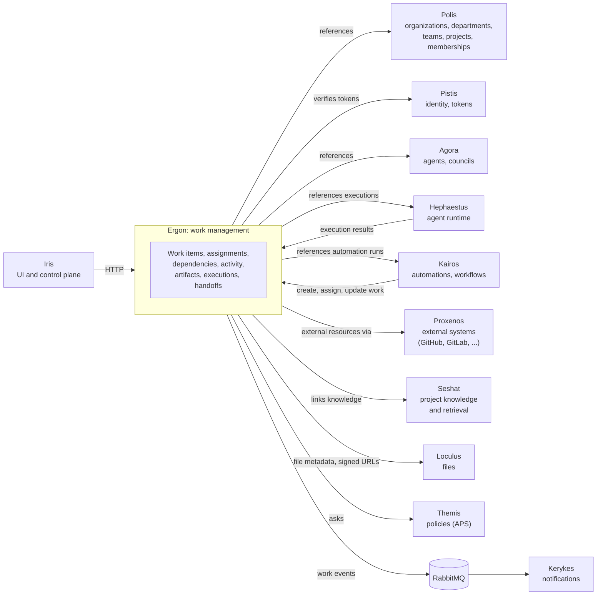
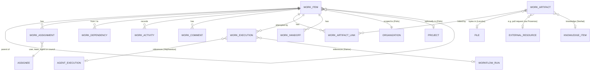
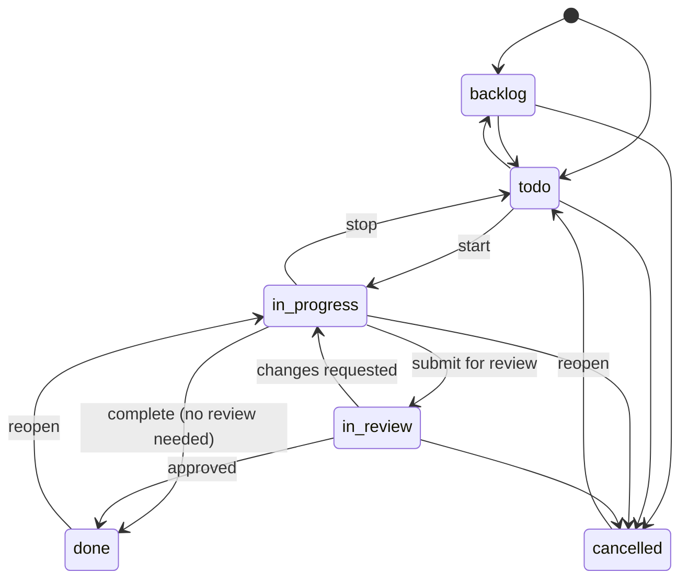

# CLAUDE.md

This file provides guidance to Claude Code (claude.ai/code) when working with code in this repository.

## Ergon

Ergon is the Aether OS service for **work management and coordination**: one model for the work that humans, teams, AI agents and agent councils do together. *Ergon* is Greek for "work, deed, task": the thing done, as opposed to the one doing it.

Package: **`@aether-os/ergon`**.

Status: **first slice built** (roadmap steps 1 to 3): work items with their lifecycle and activity, assignments (to persons and agents, copied from Polis's and Agora's events), and dependencies with cycle detection and derived Blocked, on port `3013` (What's built, below). This file is the agreed design for the rest. It says what Ergon owns, how it fits with the other services, and which rules its code must follow. Sections and lines marked **(Proposal)** are suggestions still to be decided. Everything else is a decision; change it on purpose, in this file, not by drifting in code.

Read the root `../CLAUDE.md` first. It describes the platform, the shared conventions (Krepis, contracts, events, identity) and how the workspace is built. This file adds only what is particular to Ergon.

## Aether OS, briefly

Aether OS combines two closely connected capabilities:

- **Agent factory:** define, configure, evaluate, deploy and operate AI agents and agent councils.
- **Organizational operating system:** model organizations, departments, teams, applications, knowledge, responsibilities, processes and work.

Humans, teams and agents work in the same environment: they share knowledge, follow the organization's processes and coordinate. The platform is made of independently deployable services. Each one owns its domain and its data, and they talk through explicit HTTP APIs and RabbitMQ events, never through each other's databases. Every package uses the `@aether-os/*` namespace.

## Mission

Ergon connects **what an organization intends** with **what actually gets done**. For any piece of work, it answers:

- What needs to be done, and why does this work exist?
- Who is responsible, and who else takes part?
- What is blocking it, and what depends on it?
- What has it produced, and what happened while it was being done?
- Does a person need to review it, approve it or take it over?
- What is its outcome now?

It is not just a task tracker. Human work management and agent work management are **one domain model**. A work item can be assigned to a user, a team, an agent or a council, and can move between them during its life. An agent may do the work, ask a person for help, delegate part of it to another agent, or submit its result for review. People can follow agent work, collaborate on it and take it over at any point.

## Where Ergon sits



Ergon is a first-class service of its own, not a module of Polis, Agora, Hephaestus or Kairos.

## Service ownership boundaries

| Service | Owns | Ergon's relationship to it |
|---|---|---|
| **Polis** | Organizations, departments, teams, memberships, projects, the organizational hierarchy | Ergon references them by ID. It never stores or manages hierarchy. |
| **Pistis** | Human identity, authentication, OIDC and OAuth, JWT and JWKS (and service accounts and tokens for agents) | Ergon verifies Pistis tokens (through Krepis) and references users by their Pistis `sub`. It has no identity system of its own. |
| **Agora** | Agent definitions, configuration, capabilities, versions, templates, and agent councils | Ergon references agents and councils, and their versions where that matters. It holds no agent configuration. |
| **Hephaestus** | The agent runtime: executing agents, runtime state, the execution lifecycle | Ergon coordinates work given to agents. It holds a **reference and projection** of an execution. Hephaestus stays the source of truth for execution state. |
| **Kairos** | Automations and workflow orchestration: automation and workflow definitions and versions, event-driven and scheduled automations, workflow execution, branching, retries, waits, long-running processes, approval steps inside workflows | Kairos creates, assigns and updates work through Ergon's API and can start agents through Hephaestus. Ergon holds a **reference** to an automation or workflow run. |
| **Proxenos** | Connections to external systems: the GitHub App and other providers' connections, OAuth, third-party APIs and adapters, integration credentials, verified webhooks turned into events | Ergon reaches GitHub, GitLab and others only through it, and keeps the link between an external resource and the work. |
| **Seshat** | Project knowledge: documents, decisions, facts, conventions and lessons, with their lifecycle (proposed → accepted → superseded), versions, and their retrieval (hybrid search, including vectors) | Ergon links work to knowledge items and can make work content available for indexing. A document produced during work does **not** automatically become accepted knowledge. |
| **Loculus** | File and object storage | Loculus stores the bytes. Ergon owns the metadata of work artifacts and their relationships to work. |
| **Themis** | Policies: versioned Rego policy sets per organization and project, served to OPA and enforced with the Agent Policy Specification (APS) | Ergon respects its decisions. An assignment never grants access to anything. |
| **Kerykes** | Notifications and inboxes (in Iris, email, later Slack and Teams) | Ergon emits work events; Kerykes decides whom to tell and delivers. |
| **Iris** | The unified UI and control plane | Iris presents Ergon through Ergon's API. Ergon has no end-user application. |
| **Krepis** and **contracts** | `@aether-os/krepis`: the shared NestJS foundation (tokens and permissions, events and the outbox, transactions, pagination, HTTP conventions, telemetry). `@aether-os/contracts`: every service's OpenAPI and AsyncAPI specs | Ergon is built on Krepis and publishes its specs in contracts. Agents reach Ergon through tools on MCP tool servers (`../hephaestus/CLAUDE.md`, Tool servers), as they reach Seshat's knowledge. |

### Current state of the platform

What Ergon's design relies on that isn't built yet. **Don't build these inside Ergon:** they belong to the owners above.

| Capability | Owner | Today |
|---|---|---|
| Departments and teams | Polis | Polis has departments, persons and teams. Ergon can't assign work to a team yet: that waits for Ergon to know Polis's teams (from its events). |
| Workflow orchestration | Kairos | Kairos runs **automations**: a trigger (a GitHub issue event, with filters) fires a `task.create` command at Hephaestus and follows its run (`../docs/automations.md`). Workflows with branching, waits, schedules and approval steps are still to come there. |
| Policy enforcement | Themis | **Planned, not built.** APS enforcement is to live in Hephaestus, with OPA pulling Themis's bundles. |
| Other providers (GitLab, Slack, Jira, …) | Proxenos | Only the GitHub App so far. |
| **Work units for agents** | Ergon's work items, with Hephaestus as runtime only | **Hephaestus owns tasks** (`../docs/tasks.md`): tasks and subtasks, `dependsOn`, the task lifecycle, artifacts (including `pull_request`), reviews, task templates, acceptance criteria and verification, executions. How the two relate is decided, below. |

**Ergon and Hephaestus's tasks (decided).** Hephaestus models agent work as *tasks*: they run as service accounts with a pinned agent version, have acceptance criteria and verification, and produce artifacts and reviews. The two fit together like this:

- **An Ergon work item is the organizational unit of work.** It is assignable to anyone and tracked for the organization.
- **A Hephaestus task is the runtime unit:** one agent doing a work item, or part of one, with its pinned version, sandbox, verification and run artifacts.
- **Ergon references tasks and executions and their artifacts, without copying them.** `WorkExecution` references a Hephaestus task and its executions; Hephaestus's artifacts surface in Ergon as `WorkArtifact` relationships.
- **Run-level reviews and verification stay in Hephaestus.** Ergon doesn't reimplement them; it records only the work item's outcome (its transitions, and later its handoffs).

The same decision is written into `../docs/tasks.md` (Decisions) and `../hephaestus/CLAUDE.md` (Overview).

## What Ergon owns

- **Work items**, their lifecycle, and their hierarchy (parent and child work).
- **Responsibility and participation:** who is responsible, who contributes, reviews or observes.
- **Dependencies** between work items.
- **The work record:** activity, comments, and the outcome.
- **Artifact relationships:** which inputs, outputs, references, evidence and deliverables belong to which work, with metadata. The content stays with its owner.
- **Execution references:** which executions (by people, agents or workflows) were attempts at which work, with a projection of their state.
- **Handoffs:** requests to transfer responsibility, and their outcome.
- Later: **queues** and **templates** of work.

## Domain model

These are starting points for the model, not a list of features to build at once. The build order is in the Roadmap.



Every entity carries `organizationId`, and every query is scoped to it (Security and multi-tenancy).

### WorkItem

The central entity: one unit of work.

- **Attributes:** `id`, `organizationId`, optional `projectId`, `title`, `description`, `type`, `status`, `priority`, `createdBy` (a principal reference), `parentId`, `dueAt`, `startedAt`, `completedAt`, `source` (how it came to exist: a person, an agent, a workflow, an external event such as a GitHub issue, with its reference), `metadata`, and `version` (concurrency control and events' `aggregateVersion`).
- **No project needed.** A work item can exist outside any project, for example a department's or team's work.
- **Types:** `task`, `bug`, `feature`, `incident`, `research`, `improvement`, `review`, `initiative`. A fixed enum to start (built), configurable per organization later.
- **Hierarchy:** a child is a work item with a `parentId`, the same entity. Hierarchy (what it's part of) is independent of dependencies (what must happen first).
- **Fields:** align with the fields Hephaestus tasks already use (`requirements`, `expectedOutcome`, `acceptanceCriteria`, `context`, `constraints`, `deliverables`, `../docs/tasks.md` Task fields), so a work item handed to an agent becomes a task brief without translation. Built: `requirements`, `expectedOutcome`, `constraints`, `acceptanceCriteria`; `context` and `deliverables` come with artifacts.

### WorkAssignment

Who is responsible for the work, and who takes part.

- **Assignee:** `{ kind: person | agent, id }` (built), later `team` and `council`, plus the agent's version when the assignment is pinned to one. A person is Polis's (the people of an organization, linked to a Pistis user once they sign up), not a Pistis user, so work can be assigned to someone who hasn't signed up yet.
- **Only known assignees (decided):** Ergon keeps local copies of Polis's persons (`person.created`, `.updated`, `.deleted`) and Agora's agents (`agent.created`, `.archived`), version-guarded, and assigns only to an active one of the organization (`UNKNOWN_ASSIGNEE`, `AGENT_ARCHIVED`). Deleting the person or archiving the agent ends their active assignments, as Ergon's own work (no actor).
- **Roles:** `responsible`, `contributor`, `reviewer`, `observer`.
- **Accountability is separate from participation.** A work item has **at most one `responsible` assignment** at a time (none while unassigned), and any number of the others.
- **History:** reassignment ends the old assignment and starts a new one (with `assignedBy`, `reason`, timestamps). It never overwrites, so the activity shows who held the work and when.
- **An assignment grants no access** to anything (Security and multi-tenancy).

### WorkDependency

A relationship between two work items in the same organization.

- **Kinds:** `blocks` (stored once; "blocked by" is the same edge read from the other side) and `relates_to`.
- **No cycles:** a `blocks` edge that would create a cycle is refused when it is created.
- **Across projects:** allowed within one organization, with `work:write` on both sides. That is unlike Hephaestus's `dependsOn`, which stays inside one task tree.

### WorkActivity

An append-only, chronological record of what happened to a work item. Examples:

- created; status changed (from → to, by whom, why);
- assignment changed;
- comment added;
- dependency added or removed;
- artifact linked;
- execution started or finished;
- handoff requested or resolved;
- completed.

Each entry has the actor (a person, an agent or a service) and the time, and is written in the same transaction as the change. It records the work's history for people. It is not the event bus, although most entries correspond to a published event.

### WorkComment

Discussion on a work item, by people and agents alike. The author is a principal reference, with an agent's version when an agent wrote it. Edits keep the earlier text in the activity.

### WorkExecution

A record that something attempted the work.

- **Who executes:** `human`, `agent` or `workflow`.
- **For an agent:** the Hephaestus task or execution ID. **For an automation or workflow:** the Kairos run ID. **For a person:** no external reference.
- **Projected state:** `status`, timestamps and a summary, updated from the owner's events. **The owner stays authoritative**; Ergon never drives an execution.
- **Many per work item:** retries, handoffs, several agents in turn.
- **Success doesn't complete the work.** A successful execution means the attempt finished. Whether the work item is `done` depends on its outcome: review, validation or more work may still be needed. Completing a work item is a separate, explicit transition.

### WorkHandoff

A request to move responsibility, and how it was resolved. Examples:

- an agent asks a person for review;
- a person delegates to an agent;
- an agent delegates part of the work to another agent (usually as a child work item);
- an agent asks for help;
- a person takes over an agent's failed work.

It has `from`, `to` (an assignee, or "any reviewer in team X"), `kind` (`review`, `delegation`, `assistance`, `takeover`), `reason`, `status` (`requested`, `accepted`, `declined`, `cancelled`) and the resulting assignment change. A takeover by a person who may take it can be immediate **(Proposal)**.

### WorkArtifact

An input, output or reference belonging to work: documents, reports, designs, architecture diagrams, source changes, **pull requests**, commits, branches, releases, issues, test results, builds, deployments, datasets, meeting summaries, screenshots, recordings.

- **Artifact and link are separate entities.** A `WorkArtifact` describes the thing: `kind`, `title`, and where it lives (a Loculus file ID; an external resource through Proxenos, such as provider, repository and number; a Seshat knowledge item ID; a Hephaestus artifact ID). A `WorkArtifactLink` ties it to a work item with a role: `input`, `output`, `reference`, `evidence` or `deliverable`. One artifact can belong to several work items. The work item has no single artifact field.
- **Content stays with its owner.** Loculus stores the bytes, and Ergon stores the file ID, never a signed URL (`../CLAUDE.md`, Design rule). GitHub or GitLab is the source of truth for a pull request; Ergon keeps the link and a synchronized projection (state, title, URL), updated from Proxenos's events. Seshat owns the lifecycle of project knowledge; linking a document to work, or producing one during work, doesn't make it accepted knowledge (an agent's proposal still waits for a person, `../docs/knowledge.md`).

### WorkQueue and WorkTemplate (later)

- **WorkQueue:** a named collection of work awaiting assignment, processing or review (for example, "triage for team X" or "needs human review"). **(Proposal)** defined by filters over work items plus an owner, not by copying items.
- **WorkTemplate:** a reusable definition of a kind of work (fields, default assignees, children). **(Proposal)** relate it to Hephaestus's task templates rather than duplicating them, following the decision above (a task is the runtime unit).

## Work lifecycle

Statuses: `backlog`, `todo`, `in_progress`, `in_review`, `done`, `cancelled`.

**Blocked is derived, not set (decided).** A work item is *blocked* while any item that `blocks` it is neither `done` nor `cancelled` (cancelled work will never be done, so it stops blocking). Ergon computes that from the dependencies and shows it next to the status (`blocked` on every work item), rather than as a status people must keep in step. There is no `work-item.blocked` event: consumers follow the blockers' `work-item.status-changed` and `work-dependency.*`. Blocked doesn't stop a transition; it's information. Blockers that aren't other work items get a reason later.



- **Explicit transitions:** the allowed (status, action) pairs are a pure table in the domain, tested exhaustively. Anything else is refused with a domain error, as Hephaestus does with `task-transitions.ts`. Every transition writes WorkActivity and publishes its event.
- **Review before done:** whether a work item needs review before `done` is a property of the item (set from its type, its template or the person creating it). A work item that needs review can only reach `done` through `in_review`.
- **Children:** a child is in its parent's project, and a parent can't reach `done` while a child is neither `done` nor `cancelled` (`CHILDREN_OPEN`); this isn't derived automatically. No children under closed work.
- **No workflow engine in Ergon.** The lifecycle is fixed and small. Configurable processes (approval chains, branching, waits, schedules) are Kairos's (its workflows, still to come), which drive Ergon's transitions through its API.

## Humans and agents working together

People and agents act on the same work items through the same API, under the same rules. Agents never touch Ergon's database; they use Ergon's API, or the tools that wrap it (an MCP tool server).

```mermaid
sequenceDiagram
    actor User
    participant Iris
    participant Ergon
    participant Kairos
    participant Hephaestus
    participant Agent as Agent (running in Hephaestus)

    User->>Iris: create work item, assign to an agent
    Iris->>Ergon: POST work item, POST assignment (agent from Agora)
    Ergon-->>Kairos: work-item.assigned (event)
    Kairos->>Hephaestus: start the agent on the work (or Ergon's own trigger, see below)
    Hephaestus-->>Ergon: execution started (event)
    Ergon->>Ergon: WorkExecution (agent, Hephaestus reference), status in_progress
    Agent->>Ergon: child items, comments, artifacts (API / tools)
    Hephaestus-->>Ergon: execution completed (event, with its artifacts)
    Ergon->>Ergon: execution projected; outcome linked as artifacts
    Agent->>Ergon: request handoff (review)
    Ergon-->>User: work-handoff.requested (delivered by Kerykes)
    User->>Iris: approve, request changes, or take over
    Iris->>Ergon: resolve handoff / transition
```

- **Who starts the agent (decided, built).** Assigning work to an agent records responsibility; it doesn't run the agent by itself. An automation in Kairos (`ergon.work-assigned`, `../docs/automations.md`) reacts to the assignment (`work-assignment.changed`) and starts it, as Kairos already starts tasks from GitHub issues: the task is the work item's brief, with its work context (`workContext`: work item, organization, agent, department, team), which the agent sees in its prompt and its tools in their request context. Ergon never calls Hephaestus and never orchestrates, not even for "assign and run".
- **The agent's identity.** In Hephaestus, agents run as **service accounts** with task tokens (`../docs/identity.md`). When an agent calls Ergon, the token says which service account, task, agent and version it is. Ergon records that as the actor, and checks the call against the work item and policy, not against the assignment alone.
- **Councils.** A council is assigned like an agent. In Hephaestus a council works through a council session (`../docs/councils.md`), and its delegated work becomes work items (and tasks) for its members. A child item's assignment records it was assigned by the council's facilitator.
- **Taking over.** A person can take over an agent's work item at any time (a `takeover` handoff). The agent's running execution is cancelled through Hephaestus, not by Ergon changing execution state.

## Events and integration contracts

Ergon follows the platform's messaging conventions (`../docs/events.md`), through Krepis's `EventsModule`:

- **Transactional outbox:** an event is written in the same transaction as the change, and a relay publishes it.
- **Exchange:** a topic exchange `ergon.events`, with the event type as routing key.
- **Delivery:** at least once. Consumers deduplicate on `eventId`.
- **Envelope:** Krepis's `DomainEvent`, with `eventId`, `eventType`, `aggregateId`, `aggregateVersion`, `occurredAt`, `organizationId`, `projectId` and `actor`. Correlation and causation identifiers come from trace context (`traceparent` in the AMQP headers); add explicit `correlationId` / `causationId` to the envelope only if traces prove insufficient, in Krepis for every service.
- **Contract:** the AsyncAPI spec `../contracts/ergon.asyncapi.yaml`, with types generated from it.

**Event names (decided).** The platform convention: `<aggregate>.<past-tense or state>` with hyphens inside words, such as `task.status-changed` and `skill-version.published`. Published so far (`../contracts/ergon.asyncapi.yaml`):

- `work-item.created`, `.updated`, `.status-changed` (done and cancelled are status changes, not events of their own);
- `work-assignment.changed` (started or ended; a reassignment is one of each);
- `work-dependency.created`, `.removed`.

Later steps add `work-handoff.requested`, `.resolved`, `work-artifact.linked`, `work-execution.started`, `.completed`. Blocked is derived and has no event.

**Commands Ergon may accept (Proposal):** for example `work-item.create`, so Kairos can create work while Ergon is down, with an idempotency key, like Hephaestus's `task.create` (`../docs/events.md`, Commands).

**Not everything needs an event.** Reads and operations that need an immediate answer (creating a work item from Iris, checking a dependency) are synchronous HTTP calls. Events announce what changed, for whoever cares.

| With | Direction | How |
|---|---|---|
| Polis | in | `person.*` (built: the persons work is assigned to); later organization suspended, project archived and teams. Tenancy is asked of its API on writes for now (`libs/tenancy`) |
| Pistis | in | Tokens verified with Krepis's `AuthModule` (JWKS); users referenced by `sub` |
| Agora | in | `agent.created`, `agent.archived` (built: the agents work is assigned to); later `council.*` |
| Hephaestus | in and out | Out: references to tasks and executions. In: its `task.*` / execution events update `WorkExecution` projections and link its artifacts |
| Kairos | in | Calls Ergon's API, or sends commands, to create and update work. Ergon references its runs |
| Proxenos | in | Events about pull requests, issues and pushes, to update external artifact projections and the work they're linked to |
| Kerykes | out | Consumes Ergon's events: built, `work-assignment.changed` (the person assigned) and `work-item.status-changed` to `in_review` (who reviews it, read from `GET …/assignments`); later handoffs |
| Seshat | out (Proposal) | Work content offered for indexing, by event |
| Loculus | out | Signed URLs for artifact files; Ergon keeps file IDs |
| Iris | in | Ergon's HTTP API (the OpenAPI spec `../contracts/ergon.openapi.yaml`) |

## Security and multi-tenancy

- **Everything is organization-scoped.** Every entity has `organizationId`. Every lookup filters on the token's organization, and another organization's resource is a 404, never a 403 (`../docs/identity.md`).
- **Tokens, permissions and tenancy through Krepis.** That covers `AuthGuard`, `@RequirePermission`, `AccessControl` and the one role → permission table. Ergon adds its permissions to that table (`work:read`, `work:write`, `org:work:read`, `org:work:write` so far; perhaps `work:review` with handoffs) rather than inventing its own role model.
- **Who may see and change a work item:** project permissions for work in a project (`work:read`, `work:write`); organization permissions for work outside one (`org:work:read`, `org:work:write`; later team and department ones); built. Assignment-based rights only where that is explicitly decided **(Proposal)**: an assignee may comment on and transition the work assigned to them, nothing wider.
- **Agents** act with their task tokens (service accounts, limited to one project) or session tokens (a person's, read-only); Ergon checks them like any principal. Policy decisions on agent actions come from Themis (APS) and fail closed.
- **An assignment is not an access grant.** Being assigned a work item doesn't give access to its repository, documents, applications, files or external systems. Each of those is decided by the service that owns it, with the caller's own token. Ergon never hands out credentials and never proxies content it doesn't own.
- **Artifacts:** Ergon shows what an artifact is (its metadata) only to those who may see the work item. Reading the content (a Loculus file, a pull request, a document) is checked by its owner.
- **Auditability:** every change records its actor in WorkActivity and in its event, and no secret or token is ever stored in a work item, comment or artifact.

## Architectural principles and development guidelines

### Decided

- **An independent service, `@aether-os/ergon`**, in this monorepo next to the others (`../pnpm-workspace.yaml` lists it once it is created), deployable on its own, with its own Postgres database and migrations.
- **Same stack and conventions as the other services** (`../docs/engineering.md`, `../docs/api.md`). That means NestJS (ESM, TypeScript), TypeORM on Postgres with migrations, `typeorm-transactional`, Zod DTOs and HTTP clients generated from the OpenAPI spec with `@hey-api/openapi-ts`, RabbitMQ through Krepis's messaging module, OpenTelemetry and Winston logging through Krepis, health checks, and tests against Postgres and RabbitMQ in containers (Testcontainers).
- **API rules:** only `GET`, `POST`, `PUT` and `DELETE` (state changes such as `start` or `complete` are `POST` actions), `/v1` paths, UUIDs (v7), RFC 9457 problem details, cursor pagination.
- **Spec-first:** the OpenAPI and AsyncAPI specs in `../contracts` are written before the code and are the contract that Iris, Kairos, tools and agents use.
- **Layers kept apart: domain, application, infrastructure, transport.** The domain (work items, the transition table, dependency rules, cycle detection) is plain TypeScript, with no Nest, TypeORM or broker in it, and is unit-tested on its own. Other services and external systems sit behind injected interfaces (ports), with their HTTP clients generated from those services' specs.
- **Within the platform's structure.** The platform's `controller → service → repository` rule with mappers applies at the application and infrastructure layers (at most 7 injected dependencies per class, services injecting services, never another module's repository). The pure domain sits beneath it.
- **References, not copies.** Entities owned elsewhere are referenced by stable ID. A local copy exists only where Ergon needs it for its own rules (organization and project status, agent existence), is kept from the owner's events, and is version-guarded, like Hephaestus's copies.
- **No database across service boundaries,** in either direction.
- **Humans and agents are both first-class** in every API: an actor is a principal (user, service account, service), never assumed to be a person.
- **Explicit domain concepts** over generic "entity" or "relation" tables. Keep the first implementation small, with no abstractions that a second use hasn't asked for.
- **Auditable and organization-scoped,** everywhere.

- **Libraries under `libs/`** (`core`, `tenancy`, `work-items`), as in the other services, with the pure domain in each library's `domain/` folder.

### Proposed

- A `work-item.create` command for internal callers, beside the HTTP API.
- Ergon's own MCP tool server (work items, comments, artifacts, handoffs) that agent versions can choose, as Seshat's knowledge tools are offered today.

## Roadmap

The first implementation lays the foundation of work management, in this order:

1. **WorkItem and its lifecycle:** the entity, types, the transition table, the API, WorkActivity for transitions. Decide on derived Blocked first.
2. **WorkAssignment:** persons and agents first. Teams wait for Ergon to know Polis's teams; councils are assignable like agents, once Ergon keeps their copy too.
3. **WorkDependency:** `blocks` and `relates_to`, cycle detection.
4. **WorkComment and WorkActivity.**
5. **WorkArtifact and links:** Loculus files and external resources first.
6. **WorkExecution references:** Hephaestus and Kairos projections from their events.
7. **WorkHandoff:** after the Ergon ↔ Hephaestus decision on reviews.
8. **Integration contracts:** Polis, Pistis, Agora, Hephaestus, Kairos, Proxenos.
9. **Event contracts and the outbox:** the AsyncAPI spec comes with step 1. Every later step adds its events there.
10. **Tool contracts for agents.**

Later: queues, templates, scheduling and planning (estimates, cycles, roadmaps).

Steps 1 to 3 are built (What's built, below), with the AsyncAPI spec's first events (step 9). Step 4's comments come next.

## What's built

The first slice, on port `3013` with its own database `ergon`:

- **Work items** (`libs/work-items`): `POST`/`GET …/work-items` (a project's with `projectId`, otherwise the organization's work outside any project), `GET`/`PUT …/work-items/{id}` (the full content; `If-Match` with the `version`, `412` on a stale one), `POST …/transitions` with an action (`plan`, `defer`, `start`, `stop`, `submit`, `request_changes`, `approve`, `complete`, `cancel`, `reopen`; the pure table in `domain/lifecycle.ts`, tested exhaustively). Fields: type, title, description, priority, `needsReview`, the brief Hephaestus's tasks use (`requirements`, `expectedOutcome`, `constraints`, `acceptanceCriteria`, as key and description), `dueAt`, `source` (person, agent, automation or external, with a reference), and the derived `blocked` and `responsible`. Deliverables and pinned context come with artifacts.
- **Owners:** optional `departmentId` and `teamId` on a work item (the department and team that own the work, set by the UI, e.g. the project's department), checked against Polis when given or changed (an active one of the organization, else `400`; one archived since may stay), in its events' snapshot, and passed by Kairos into the task's work context. `GET …/work-items/{id}` and `GET …/work-items/{id}/assignments` also take platform services' tokens (`platform:read`, work in a project only): Kairos reads the work it starts an agent on, Kerykes who reviews it.
- **Activity:** `GET …/work-items/{id}/activity`, oldest first: created, updated (the changed fields), status changed (from, to, action, reason), assignment started and ended, dependency added and removed, each with its actor, written in the transaction of the change.
- **Assignments:** `POST`/`GET …/work-items/{id}/assignments` and `POST …/{assignmentId}/end`: persons (Polis's IDs) and agents (Agora's IDs, optionally a version), only ones Ergon knows in the organization (`libs/assignees`: copies from `polis.events` and `agora.events`, version-guarded upserts), roles `responsible` (at most one active; a new one ends the old, "Reassigned"), `contributor`, `reviewer`, `observer`. Not on done or cancelled work. A deleted person's or archived agent's assignments end. Persons and agents created before Ergon subscribed are unknown until an operator runs Polis's `POST /v1/persons/announce` and Agora's `POST /v1/agents/announce` (once per environment; repeating them is harmless).
- **Dependencies:** `POST …/work-dependencies` (`blocks` or `relates_to`, across the organization's projects, `work:write` on both sides), `DELETE …/work-dependencies/{id}`, `GET …/work-items/{id}/dependencies` (at most 200 per work item). A `blocks` edge that would close a cycle is refused (`domain/dependency-graph.ts`, with a recursive query for what the blocked item leads to, under a per-organization advisory lock); `relates_to` is stored once, smaller ID first.
- **Permissions** (Krepis): `work:read` / `work:write` in a project, `org:work:read` / `org:work:write` for work outside any project (never with a token limited to one project); session tokens read only. Routes check the organization (`org:read`); `WorkAccess` checks the work item's scope. Writes ask Polis whether the organization and project accept them (`libs/tenancy`, Ergon's own Pistis client `ergon`).
- **Events** through the outbox to `ergon.events`; consumed: Polis's `person.*` and Agora's `agent.created` / `.archived` (queues `ergon.polis-events`, `ergon.agora-events`).

```bash
cp .env.example .env && pnpm start:dev   # build, migrate, watch (port 3013)
pnpm test                                # unit tests (the lifecycle, the dependency graph)
pnpm test:e2e                            # the API against Postgres and RabbitMQ (Testcontainers)
pnpm generate:api                        # types and Zod from ../contracts/ergon.*.yaml
```

## What Ergon must not own

- **Organizational structure:** organizations, departments, teams, memberships, projects, hierarchy (Polis).
- **Identity:** users, authentication, tokens, service accounts (Pistis).
- **Agent and council definitions:** configuration, capabilities, versions, templates (Agora).
- **Running agents:** the runtime, execution state, sandboxes, model calls (Hephaestus, through Pylon).
- **Workflows:** definitions, executions, schedules, retries, waits, approval steps inside workflows (Kairos). Ergon has no workflow engine.
- **External integrations:** OAuth connections, provider APIs, credentials, webhooks (Proxenos).
- **Project knowledge:** its lifecycle, approval, versions and retrieval (Seshat).
- **File storage** (Loculus).
- **Policy decisions** (Themis).
- **Notification delivery** and inboxes (Kerykes).
- **A user interface** (Iris).
- **Shared libraries and contracts** (Krepis, contracts).
- **Secrets** of any kind (OpenBao).
